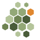

# The mark

`liken`'s icon is a patch of lichen, drawn as hexagonal tiles.

The mark refers to lichen biology, and to the way `liken` combines
Linux and Kubernetes.

A lichen is a fungus and a photosynthetic partner, an alga or a
cyanobacterium, living so closely that the pair is named and
classified as one lichen. `liken` combines the Linux kernel and `k3s`,
which remain separate upstream projects, and a machine boots them
as one system.

Lichens are also pioneers. They are among the first living things to
grow on bare rock. They survive drought, heat, and bare mineral
where nothing else grows, and they begin to turn rock into soil.
`liken` starts from a blank machine with nothing installed.

A lichen also needs very little to live. `liken` runs a Kubernetes
cluster on machines with 1 GB of memory.

## The tiles

Many crustose lichens grow flat against rock. As they age, and as
repeated wetting and drying shrinks the crust, the surface cracks into
small polygonal plates. Each plate is called an *areole*, and a
thallus built this way is *areolate*. The icon draws that mosaic, one
areole to a tile.

The areoles are drawn as hexagons because the Kubernetes community
uses hexagons, in Helm's logo and in the backdrops of community
talks. So the same picture refers to lichen on rock and to
Kubernetes.

One tile is orange and the rest are green. *Xanthoria*, one of the
most common rock lichens, is a vivid orange, and the single orange
tile gives the mark a focal point.

The tiles get smaller toward one edge of the mark. This is a design
choice, not biology. Real areoles do not reliably shrink toward the
margin, because cracking tends to start in the older center. The
pattern suggests a colony that is still spreading into bare rock.

## The colors

The greens come from crustose lichens on stone, from deep moss to
pale sage. The orange tile comes from *Xanthoria*.

| Name | Hex |
| --- | --- |
| Deep moss | `#4a5d3a` |
| Mid sage | `#6e8352` |
| Light sage | `#93a877` |
| Pale sage | `#b4c49a` |
| Xanthoria | `#e0872f` |

The mark has a transparent background, so it works on both light
and dark surfaces. Every tile is one flat color with no gradient or
effect, so the mark stays legible at favicon size and would print
in one ink.

`liken.css` uses these colors for its link color and for `--warm`,
its second accent. The comment at the top of `liken.css` lists the
shade of each in the light and the dark scheme.

## The files

`liken.svg` is the original, and every other image of the mark is
made from it, such as `favicon.ico` and the raster `liken.png` for a
GitHub avatar. `make` writes those images and the copies in `static/`
and `assets/` that the theme serves. The generated files are committed
too, so you can use a favicon or an avatar without installing a
rasterizer, and a site that uses the theme serves them with no build
step. To change the mark, edit `liken.svg`, run `make`, and commit the
files that change. The comments in the `Makefile` list each file and
the tools that `make` needs.

[`motion.md`](motion.md) has the rules for the mark in motion.

## Sources

The biology in this document comes from standard lichenology sources:

* Irwin M. Brodo, Sylvia Duran Sharnoff, and Stephen Sharnoff,
  *Lichens of North America* (Yale University Press, 2001), the
  standard field reference for the symbiosis and for growth forms.
* [British Lichen Society: Lichen
  Morphology](https://britishlichensociety.org.uk/learning/lichen-morphology),
  for areoles and the areolate crustose thallus.
* [Crustose lichen](https://en.wikipedia.org/wiki/Crustose_lichen) and
  [Lichen](https://en.wikipedia.org/wiki/Lichen), Wikipedia, for the
  mycobiont/photobiont symbiosis and the pioneer role in primary
  succession, both with citations to the primary literature.
